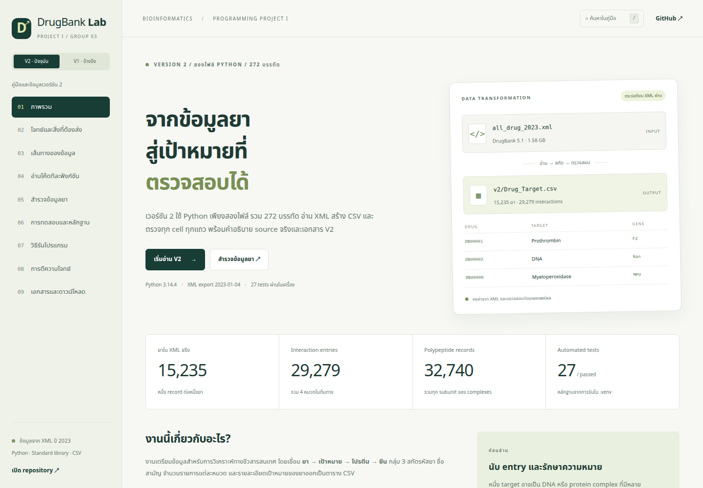

# Bioinformatics Programming Project I — กลุ่ม 3 · Version 2

**เวอร์ชันเริ่มต้นคือ V2: Python สองไฟล์ รวม 272 บรรทัด** อ่าน `all_drug_2023.xml` แล้วสร้าง `Drug_Target.csv`
พร้อมตัวตรวจอิสระที่เทียบทุก cell ทุกแถว ก่อนเผยแพร่ CSV และรายงาน JSON
ใช้ Python 3.10 ขึ้นไปและ standard library ไม่ต้องติดตั้ง packages เพิ่ม

| ไฟล์หลัก V2 | หน้าที่ | บรรทัดรวม |
|---|---|---:|
| [v2/group3.py](v2/group3.py) | อ่าน XML, spool, เขียน CSV และเรียกตัวตรวจ | 131 |
| [v2/verify_output.py](v2/verify_output.py) | ตรวจทุกแถว, audit, samples และ hashes | 141 |
| รวม | ไม่รวม tests, เว็บไซต์, เอกสาร หรือข้อมูล | 272 |

## เริ่มรัน V2

วาง `all_drug_2023.xml` ที่ได้รับจากโครงการใน root ของ repository แล้วรัน:

```bash
python3 -m venv .venv
source .venv/bin/activate
python v2/group3.py
```

หากมี `.venv` แล้ว ใช้คำสั่งเดียว:

```bash
.venv/bin/python v2/group3.py
```

ได้ **[v2/Drug_Target.csv](v2/Drug_Target.csv)** และ **[v2/Drug_Target.validation.json](v2/Drug_Target.validation.json)**
default input อ้างอิง current working directory ส่วน output default อยู่ข้างสคริปต์ V2 จึงแยกจากผล V1 ใน root
บน Windows ใช้ `py -m venv .venv` และ `.venv\Scripts\Activate.ps1`

```bash
# ตรวจซ้ำ รายงาน JSON แสดงบน stdout
.venv/bin/python v2/verify_output.py
# เปลี่ยนตำแหน่ง input/output ต้องสร้างโฟลเดอร์ปลายทางก่อน
.venv/bin/python v2/group3.py --input /path/to/all_drug_2023.xml --output /tmp/Drug_Target.csv
.venv/bin/python v2/verify_output.py --input /path/to/all_drug_2023.xml --csv /tmp/Drug_Target.csv
# ทดลอง fixture โดยไม่มี XML จริง
.venv/bin/python v2/group3.py --input tests/fixtures/drugbank_sample.xml --output /tmp/sample.csv
# ทดสอบเฉพาะ V2 / ทดสอบทั้ง repository
.venv/bin/python -m unittest tests.test_v2 -v
.venv/bin/python -m unittest discover -v
```

หากดาวน์โหลดเฉพาะสอง `.py` ให้วางทั้งคู่กับ XML ในโฟลเดอร์เดียวกัน `cd` เข้าโฟลเดอร์ แล้วรัน `python group3.py`
ไฟล์งานที่ต้องมีขั้นต่ำคือ **Python 2 ไฟล์ + XML 1 ไฟล์** ไม่ต้องมีโค้ด V1, เว็บไซต์, tests หรือเอกสารสำหรับการรันปกติ

## หลักการและผลตรวจ

- 6 base columns: DrugBank_ID, Generic_Name, Total-Target, Total-Enzyme, Total-IonChannel, Total-Transporter
- แต่ละ interaction entry เพิ่ม 6 cells: protein_number, protein_name, organism, actions, Uniprot_ID, gene_name
- คงวงเล็บเหลี่ยมและแถวต่างความกว้างตามภาพโจทย์; เริ่มเลขใหม่ทุกหมวด; ข้อมูลหายใช้ Nan
- รวมทุก action/UniProt/gene ด้วย ` | ` และรักษา Nan placeholders; ไม่ deduplicate ข้ามบทบาท
- XML จริง: **15,235 ยา / 29,279 entries** — targets 19,344; enzymes 5,683; carriers 918; transporters 3,334
- มี 32,740 polypeptide records และ 618 complexes; JSON ของ V2 เก็บชื่อ/organism/UniProt/source/gene ทุก subunit
- **V2 tests ผ่าน 27 กรณี** มี golden, mutation ในแถวที่ไม่ใช่ sample, isolated two-file CLI และ Python -O
- CSV V2 มี SHA-256 ตรง CSV V1 ทุก byte: `7a53dcdf3343c23cc8f14abf52488191a439eaa3fe36418984aa6ef43e78e255`
- ตัวตรวจอิสระอ่าน XML ซ้ำ ไม่ import exporter; รายงานมี `version=2`, expected/actual ต้น–กลาง–ท้าย และ environment

**ข้อกำกวมที่ยังต้องยืนยัน:** `Total-IonChannel` ใช้ carriers ตามสมมติฐานเดิมซึ่งไม่ใช่การจำแนก ion channels จริง
จึงแยก `verification_status=passed` จาก `specification_status=requires_ion_channel_definition`
DB00004 มี 3 targets และ DB00006 มี counts 1,1,0,0 ตาม XML แม้ภาพ PDF ต่างกัน

V2 ไม่มีโหมด TXT, `--layout table`, `--input-format` หรือ `--report` ของ V1
ข้อผิดพลาดประมวลผล exit 1 ส่วน CLI arguments ผิดรูปแบบ argparse ใช้ exit 2
เมื่อสกัด/ตรวจล้มเหลวก่อน replace ผลเดิมยังอยู่; การ replace CSV และ JSON เป็น atomic ทีละไฟล์ ไม่ใช่ transaction รวมสองไฟล์
หาก replace รายงานล้มเหลวหลัง CSV สำเร็จ ให้ตรวจ hashes ของคู่ไฟล์ก่อนใช้

## เอกสารและเว็บไซต์ V2

| เอกสาร | เนื้อหา |
|---|---|
| [รายงาน PDF](docs/Group3_Report.pdf) | สรุป V2 สองหน้า A4 |
| [บทความ V2](docs/article_v2.md) | วิธีคิด ขั้นตอน และทุกฟังก์ชันอย่างละเอียด |
| [วิเคราะห์โจทย์](docs/requirements.md) | อ่าน PDF ครบ 5 หน้าและผูกกับ V2 |
| [ผลตรวจทวน](docs/assignment_audit.md) | หลักฐาน ขอบเขต และข้อกำกวม |
| [นำเสนอ V2](docs/presentation.md) | พูด 12 นาที + ถามตอบ 8 นาที |
| [ผล tests](docs/test_results.txt) | เฉพาะ tests.test_v2 จำนวน 27 tests |
| [Benchmark V2](docs/benchmark_results.json) | ผลวัดใหม่ของ V2 บนข้อมูลจำลอง |
| [คู่มือเว็บ](docs/website.md) | build/check/browser tests/เผยแพร่ GitHub Pages |



เว็บไซต์เริ่มที่ V2: https://phattharaphum.github.io/nb-BioinformaticsProgramming/
ส่วน [04 · อ่านโค้ด V2](https://phattharaphum.github.io/nb-BioinformaticsProgramming/#code) จัดเป็น 10 บทเรียน
มีข้อมูลเข้า–ออก ตัวอย่าง และขั้นตอนที่กดไฮไลต์บรรทัดใน source จริงได้ พร้อมค้นหาฟังก์ชัน ดูโค้ดเต็มไฟล์ และจำสถานะอ่านแล้ว
รองรับคอมพิวเตอร์ แท็บเล็ต และมือถือ; ค้นยาจากผล V2 และดาวน์โหลดเอกสาร V2 ได้เช่นเดิม
Browser tests ผ่าน 39 กรณี ไม่มี page errors; [หลักฐาน](docs/website_browser_results.json) / [ภาพบทเรียน](docs/walkthrough-desktop.png) / [ภาพมือถือ](docs/walkthrough-mobile.png)
ชุดทดสอบรวม V1/V2 ในเครื่องผ่าน 93 กรณี: [log รวม](docs/all_test_results.txt)
V2 ทั้ง 27 tests ใช้ fixture ได้ใน CI; legacy TXT acceptance หนึ่งกรณีจะ skip ในเครื่องที่ไม่มี TXT จริง

```bash
.venv/bin/python tools/build_site.py
.venv/bin/python tools/check_site.py
.venv/bin/python -m http.server 8000 --directory site
```

เปิด http://localhost:8000/ ใช้ HTTP/HTTPS เพื่อให้ fetch ข้อมูลทำงาน
GitHub Actions จะ tests/build/check/deploy ทุก push main เมื่อ Pages Source เป็น GitHub Actions และ environment อนุญาต

## เวอร์ชัน 1 สำหรับอ้างอิง

โค้ดเดิม `group3.py`, `drugbank_parser.py`, `verify_output.py`, `drugbank_text.py` และผล CSV เดิมยังอยู่ใน root
เอกสารและผลทดสอบเดิมเก็บแยกที่ [docs/v1/README.md](docs/v1/README.md)
V1 ใช้โค้ดหลัก 3 ไฟล์ 652 บรรทัด; V2 ใช้ 2 ไฟล์ 272 บรรทัด ลดประมาณ 58.3%
ต้นแบบ 163 บรรทัดที่เคยทดลองตรวจเพียงต้น/กลาง/ท้าย; V2 เพิ่มการตรวจทุก cell, audit และข้อผิดพลาด จึงมีขนาดมากกว่าต้นแบบ

ตาม PDF: ส่ง Python และรายงาน PDF ไม่เกิน 2 หน้า A4 ภายใน 29 ตุลาคม 2569 ก่อนเที่ยงคืน
นำเสนอ 30 ตุลาคม 2569 เวลา 13:30–16:30 กลุ่มละ 12 นาที + ถามตอบ 8 นาที
คำว่าอังคารใน PDF ขัดกับวันที่จริงซึ่งเป็นพฤหัสบดี ควรยืนยันกำหนดส่งกับผู้สอน
